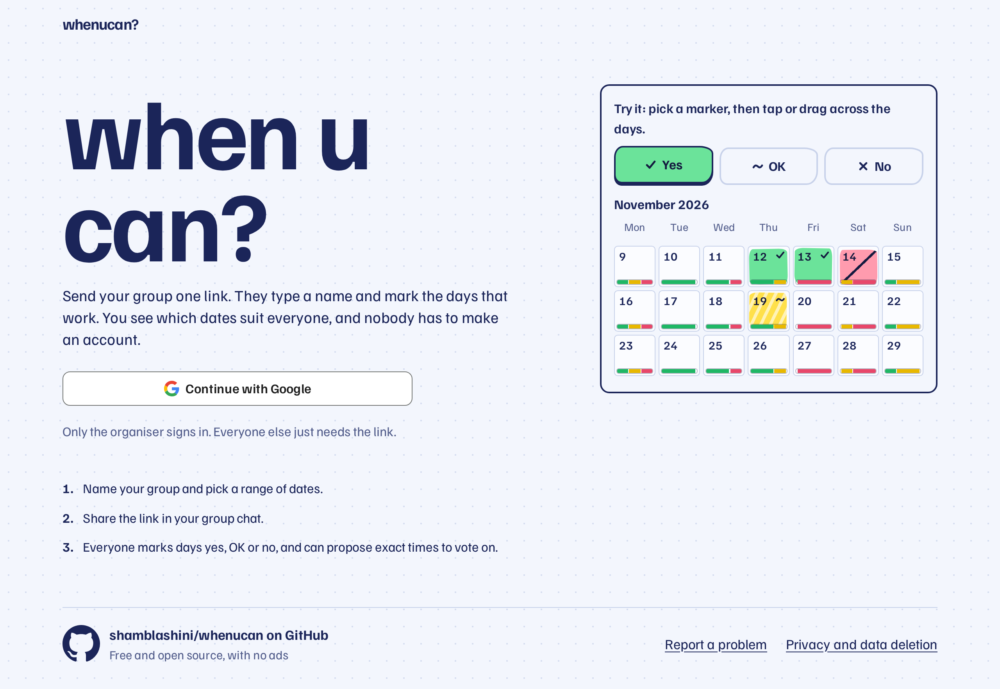
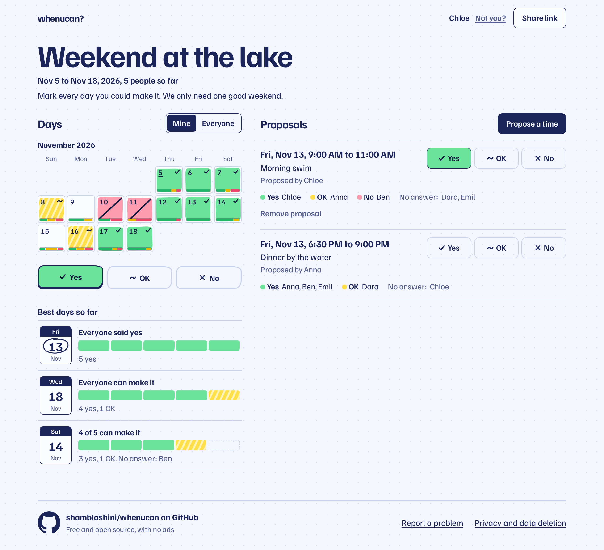
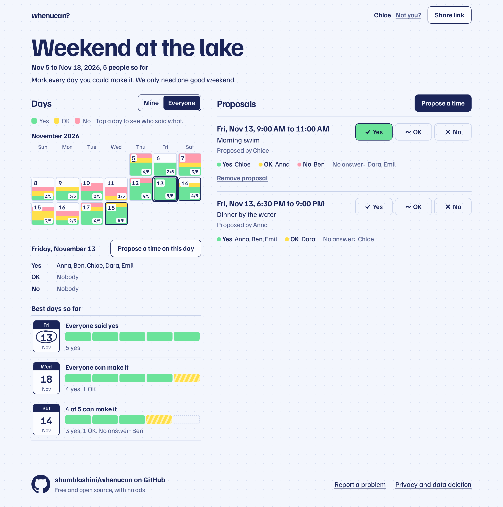
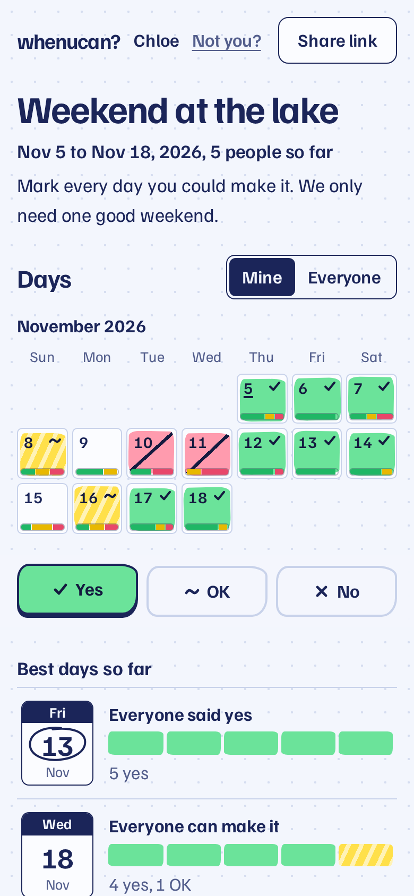
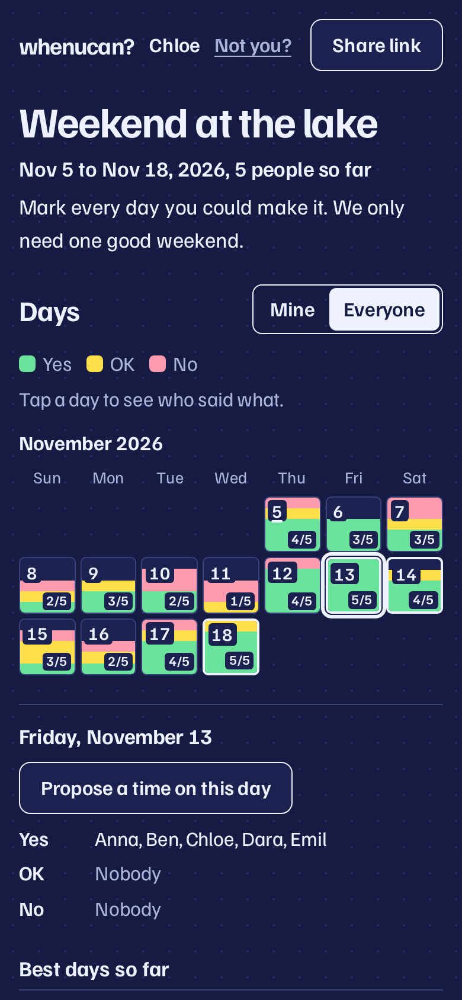

<div align="center">

# when u can?

**Find a date with your group. Send one link, and nobody else needs an account.**

[Open whenucan.app](https://whenucan.app) · [Run your own copy](#run-your-own-copy) · [Report a problem](https://github.com/shamblashini/whenucan/issues)

<br>

<picture>
  <source media="(prefers-color-scheme: dark)" srcset="docs/screenshots/landing-dark.png">
  
</picture>

</div>

## How it works

1. **Create a group.** The organiser signs in with Google, names the group and picks a range of dates.
2. **Share the link.** Paste it in your group chat. Anyone who opens it types a name and starts answering.
3. **Mark your days.** Pick a yes, OK or no marker, then tap or drag across the calendar like a highlighter on a paper planner.
4. **Agree on a time.** Everyone sees the best days as they fill in, and anyone can propose an exact time for the group to vote on.

<div align="center">
<picture>
  <source media="(prefers-color-scheme: dark)" srcset="docs/screenshots/planner-dark.png">
  
</picture>
</div>

## See who can make it

The Everyone view shows how each day is filling up. Tap a day to see who said what. The best days show one stroke per person, so you can spot the date that works at a glance.

<div align="center">

</div>

## Made for phones, too

Most people will open the link from a group chat. Marking days works with a thumb, and scrolling the page never marks a day by accident. The app also follows your light or dark setting.

<table align="center">
  <tr>
    <td></td>
    <td></td>
  </tr>
</table>

## What's in it

- **No accounts for guests.** Only the organiser signs in. The same name on another device is the same person.
- **25 European languages plus English.** The app follows the browser's language. [Add yours](#add-a-language).
- **Your clock format.** 24-hour time in Europe and wherever the language uses it. Dates follow the language too.
- **Calendars.** Add any proposed time to Google Calendar, Apple Calendar, Outlook or any app that opens `.ics` files, in the group's time zone.
- **Live updates.** Other people's answers appear within seconds, with no reload.
- **Abuse protection.** Invisible Cloudflare Turnstile, rate limits and caps on people, proposals and groups.
- **Organiser controls.** Remove people, delete proposals, replace the link or delete the group.
- **Privacy by default.** Groups are deleted 90 days after their last date. There are no ads and no analytics, and the links are not indexed by search engines.

> [!NOTE]
> Names are not passwords. Anyone with the link can answer under any name, so share it only with your group. The app says this on the join screen.

## Built with

[Cloudflare Workers](https://developers.cloudflare.com/workers/), [D1](https://developers.cloudflare.com/d1/) and [Turnstile](https://developers.cloudflare.com/turnstile/), with [Hono](https://hono.dev/) on the server and [React](https://react.dev/) in the browser. One Worker serves everything. The design and its trade-offs are in [docs/design.md](docs/design.md).

## Run it locally

You need [Node.js](https://nodejs.org/) and [pnpm](https://pnpm.io/). You don't need any Google or Cloudflare credentials.

```bash
pnpm install
pnpm setup:local
pnpm dev
```

Open http://localhost:5188 and choose **Sign in as a test organiser**. To test as several people, use a private window or another browser for each one.

`pnpm setup:local` creates `.dev.vars` with Cloudflare's always-pass Turnstile test keys and a random session secret, then creates the local database.

<details>
<summary>Try real Google sign-in locally</summary>

Add your client ID and secret to `.dev.vars`, and add `http://localhost:5188/auth/google/callback` as a redirect URI on the Google client. Restart `pnpm dev`, and a **Continue with Google** button appears.

</details>

## Tests

```bash
pnpm test
```

```bash
pnpm test:e2e
```

`pnpm test` runs the API tests. `pnpm test:e2e` runs the browser tests on their own server (port 5189) with their own data in `.wrangler/e2e`, so they don't touch your local groups. They need Playwright's Chromium (`pnpm exec playwright install chromium`), or set `PW_CHROMIUM` to the path of a Chromium you already have.

## Run your own copy

You need a Cloudflare account with a domain on it, and a Google Cloud project for sign-in. Use your own domain in place of `your-domain.example`. Everything specific to a copy is in `wrangler.jsonc` and in the secrets below.

### 1. Create the Google client

In [Google Cloud Console](https://console.cloud.google.com/apis/credentials):

1. Configure the OAuth consent screen: audience **External**, status **In production**, with your privacy page `https://your-domain.example/privacy`. The app asks only for `openid`, `email` and `profile`.
2. Create an **OAuth client ID** of type **Web application**.
   - Authorised JavaScript origins: `https://your-domain.example`
   - Authorised redirect URIs: `https://your-domain.example/auth/google/callback` and `http://localhost:5188/auth/google/callback`

### 2. Create the Turnstile widget

In the [Cloudflare dashboard](https://dash.cloudflare.com/?to=/:account/turnstile), add a widget:

- Mode: **Managed**. The app shows it only when Cloudflare needs an interaction.
- Hostnames: `your-domain.example`

### 3. Create the database and fill in the config

```bash
pnpm exec wrangler d1 create whenucan
```

In `wrangler.jsonc`:

- Set the `pattern` under `routes` to your domain. The build also uses it for link previews.
- Set `database_id` to the id from the command above.
- Set `REPO_URL` to your fork, or leave it empty to hide the GitHub links.
- Set `GOOGLE_CLIENT_ID`, `TURNSTILE_SITE_KEY` and `CONTACT_EMAIL` under `vars`, replacing the values for whenucan.app. People write to `CONTACT_EMAIL` about their data, and the privacy page shows it.

The new `database_id` also gives you a new, empty local database, so run `pnpm db:migrate:local` again before the next `pnpm dev`.

### 4. Set the secrets

Run each command and paste the value when asked. For `SESSION_SECRET`, generate a value with `openssl rand -base64 32`.

```bash
pnpm exec wrangler secret put SESSION_SECRET
```

```bash
pnpm exec wrangler secret put GOOGLE_CLIENT_SECRET
```

```bash
pnpm exec wrangler secret put TURNSTILE_SECRET_KEY
```

Do not set `DEV_LOGIN` in production. It also has no effect outside `localhost`.

### 5. Deploy

```bash
pnpm db:migrate:remote
```

```bash
pnpm deploy
```

Cloudflare creates the DNS record and certificate for your domain on the first deploy.

### 6. Check it

1. Sign in with Google and create a group.
2. Open the link in a private window and join with a name. No checkbox should appear in the normal case.
3. Check that `/api/config` shows `"devLogin":false` and `"googleEnabled":true`.
4. Check the Worker's logs in the dashboard for `[auth]` or `[api]` errors.

### Changing the limits

- Per-group and per-person caps: `src/shared/limits.ts`
- Rate limits and the cleanup schedule: `wrangler.jsonc`

## Add a language

Copy `src/client/i18n/locales/de.ts` to `<language code>.ts` in the same folder and translate the values. The app finds the new file by itself. `pnpm test` checks that every key, placeholder and plural form is there. Corrections to existing translations are welcome too: they were machine-translated and no native speaker has reviewed them yet.

## Privacy requests

To see, correct or delete your data on whenucan.app, write to [privacy@whenucan.app](mailto:privacy@whenucan.app). Please don't use GitHub issues for this, because they are public. The [privacy page](https://whenucan.app/privacy) has the details.

## Security

See [SECURITY.md](SECURITY.md) to report a problem privately.

## License

[MIT](LICENSE)
